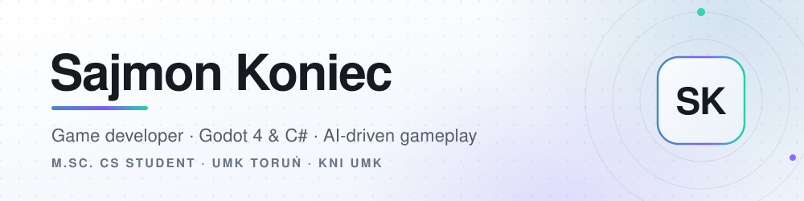

  <picture>
    <source media="(prefers-color-scheme: dark)" srcset="assets/banner-dark.svg">
    
  </picture>

  <table>
    <tr>
      <td align="center"></td>
      <td align="center"></td>
      <td align="center"></td>
    </tr>
  </table>

## Hi, I'm Sajmon 👋

M.Sc. Computer Science student at **Nicolaus Copernicus University in Toruń**, building games — mostly in **Godot 4 with C#/.NET**, with a soft spot for AI that actually changes how a game plays rather than decorating it.

- 🎓 M.Sc. student, AI specialisation — my B.Eng. thesis was an **AI Director** that adapts difficulty in real time to keep the player in a *flow* state, and I'm still extending it.
- 🎮 10+ game projects, four of them published on [itch.io](https://6ajmon.itch.io) — jam entries for GMTK, Kenney Jam, Godot Wild Jam and SCREAM JAM.
- 🧪 Member of the **Computer Science Student's Association (KNI UMK)** — I design and build hands-on exhibits that visitors can actually play.
- 🧰 Outside gamedev: Java (NeoForge mods), Python (daemons and bots), Next.js.

## 🎪 Festival projects — KNI UMK

As a member of the **Computer Science Student's Association at NCU**, I build interactive projects for the **Toruń Science and Arts Festival** — the stand where visitors walk up, pick up a mouse and play. The 24th edition (TFNiS 2026) ran on a single Godot 4 arcade shell: shared UI, input and manager layer, so each new attraction drops in as an independent mini-game.

<table>
  <tr>
    <td width="50%" valign="top">
      <h3>🔫 <a href="https://github.com/Kolo-Naukowe-Informatykow/TFNiS-laser-gun-game">Laser Gun Game</a></h3>
      
Interactive laser-gun arcade built for exhibition visitors — designed and developed for the 24th Toruń Science and Arts Festival. Godot 4.6 / C#, multi-game architecture with a common HUD and control scheme.

    </td>
    <td width="50%" valign="top">
      <h3>🧩 <a href="https://github.com/Kolo-Naukowe-Informatykow/tfnis2026-labirynt">TFNiS 2026 — Labirynt</a></h3>
      
The association's maze attraction for the same festival stand — a companion piece to the arcade, aimed at a different kind of visitor.

    </td>
  </tr>
  <tr>
    <td width="50%" valign="top">
      <h3>🧠 <a href="https://github.com/Kolo-Naukowe-Informatykow/LogJamGame">LogJamGame</a></h3>
      
2D game developed within the association. I own the design: mechanics, systems and the decisions behind them, documented as the project grows.

    </td>
    <td width="50%" valign="top">
      <h3>🖼️ <a href="https://github.com/Kolo-Naukowe-Informatykow/KNI-posters">KNI Posters</a></h3>
      
Automated poster and reel generation for the association's events — React + Remotion pipeline, with the TFNiS 2026 asset set.

    </td>
  </tr>
</table>

## 🎯 Selected work

| Project | What it is | Built with |
| :-- | :-- | :-- |
| **[ai-director-demo](https://github.com/6ajmon/ai-director-demo)** | 2D top-down shooter with a custom **AI Director** that tunes difficulty in real time to hold the player in flow — procedural dungeons, live metric-driven adaptation. | `Godot 4` `C#` `.NET 8` |
| **[LabyrythmMod](https://github.com/6ajmon/LabyrythmMod)** | NeoForge mod: procedurally generated maze where **sound is the stealth mechanic**, plus a boss fight built around it. 🏆 Winner, KNI UMK modding contest. | `Java` `NeoForge 1.21` |
| **[Deadline](https://github.com/6ajmon/Deadline)** | Fast-paced sci-fi roguelike — purge alien worlds before your power runs out. Kenney Jam 2025 entry. | `Godot 4` `GDScript` |
| **[BETRUNNER](https://github.com/6ajmon/BETRUNNER)** | Fast-paced 3D platformer, GMTK Game Jam 2026 entry. | `Godot 4` `C#` |
| **[MindStakes](https://github.com/6ajmon/MindStakes)** | Quiz-show tool for hosts — turn a room of friends into a game show. | `C#` |
| **[Story.report](https://github.com/6ajmon/Story.report)** | Instagram Story report generator (1080×1920) built from Last.fm listening data. | `Next.js` `TypeScript` |

## 🕹️ Jams & published games

Four jam entries are playable in the browser on my itch.io page:

| Game | Jam | Hook |
| :-- | :-- | :-- |
| **[BETRUNNER](https://6ajmon.itch.io/betrunner)** | GMTK Game Jam 2026 | 3D platforming at full speed |
| **[Catatonia: Breakdown](https://6ajmon.itch.io/catatonia-breakdown)** | SCREAM JAM 2025 | Polish horror, 1996, Polish creepypasta |
| **[Furrball Siege](https://6ajmon.itch.io/furrball-siege)** | Godot Wild Jam #84 | Shoot hamsters into gnome forts — physics does the rest |
| **[Deadline](https://6ajmon.itch.io/deadline)** | Kenney Jam 2025 | Meet the quota before your power runs out |

## 🛠️ Toolbox

  
  
  
  
  
  
  

  
  
  
  
  

## 📊 On GitHub

  <picture>
    <source media="(prefers-color-scheme: dark)" srcset="https://github-profile-summary-cards.vercel.app/api/cards/profile-details?username=6ajmon&theme=tokyonight">
    
  </picture>
    
  <picture>
    <source media="(prefers-color-scheme: dark)" srcset="https://streak-stats.demolab.com?user=6ajmon&theme=tokyonight&hide_border=true&background=0D1117&ring=478CBF&fire=7C5CFF&currStreakLabel=478CBF">
    
  </picture>

## 🏆 Achievements

- **Winner** — Minecraft Modding Competition, KNI UMK (2025) · [LabyrythmMod](https://github.com/6ajmon/LabyrythmMod)
- **2nd place** — Team Programming Presentations at NCU, social category · [FamilyVault](https://github.com/FamilyVaultApp)
- **Honourable mention** — 17th National Young Masters Competition (Teleinformatics Forum) · [FamilyVault](https://github.com/FamilyVaultApp)

---

  Always up for a jam team, a Godot question, or a game design argument. Best way to reach me: e-mail above.

